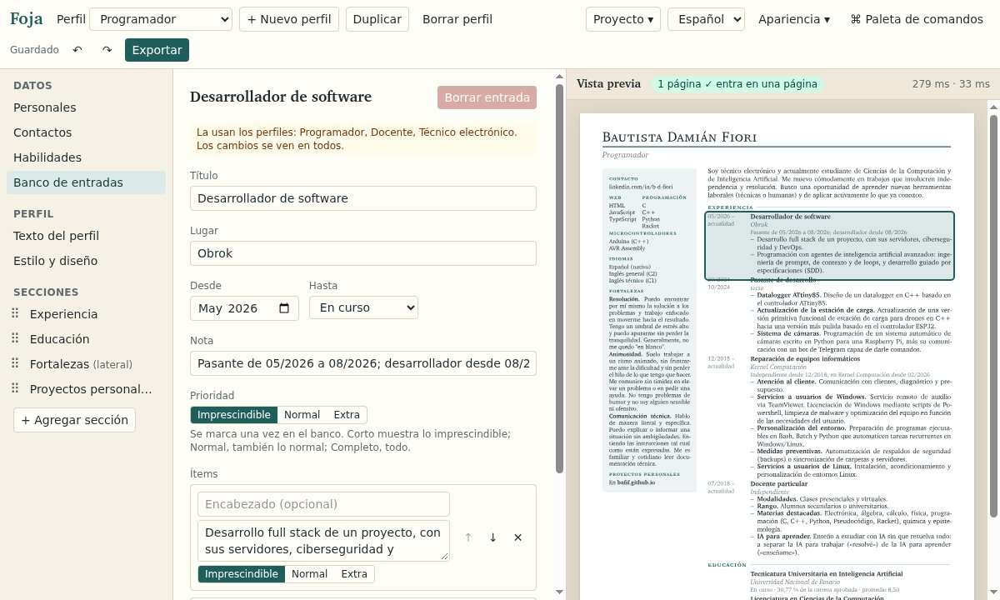

# Foja

**Tu CV en Typst, sin escribir código.** 
[English](README.md) · [Abrir el editor](https://bafif.github.io/foja/) · [Instalar](#instalar) ·
[Guía de uso](docs/guide.es.md)

Completás formularios y al lado ves la salida real de [Typst](https://typst.app), que se actualiza mientras escribís.
Un mismo banco de entradas alimenta varios perfiles: el CV para un puesto de programación y el de docencia salen de
los mismos datos. Todo corre en tu navegador, sin cuentas y sin servidor.

## Por qué Foja

- **Un banco, un CV por tipo de trabajo.** Cada entrada se escribe una vez y se marca como imprescindible, normal o
  extra; cada perfil elige sus secciones del banco, y su largo (corto, normal, completo) decide qué entra.
- **Una página, sin adivinar.** La vista previa dice si el CV entra y tiñe lo que se pasa. «Ajustar a una página»
  achica el perfil de a un paso, en un orden fijo, y un solo deshacer lo vuelve atrás.
- **Nueve estilos, y los tuyos en Typst.** Legajo, Banda y Minimal; Claustro, Recto y Llano para los sistemas de
  selección, una columna de texto en el orden en que se lee, que un test comprueba en el PDF; Arco, Rótulo y Portada
  para un CV corto. «Editar en Typst» copia cualquiera en un estilo tuyo.
- **Traé la plantilla que te guste.** Una plantilla de CV en Typst o en LaTeX se lee con reglas fijas, sin IA: su
  contenido de ejemplo pasa a ser un perfil y su aspecto un estilo, después de un formulario donde revisás qué
  argumento es cada campo.
- **Exportá a lo que te pidan.** PDF, JPG, Word, Typst, LaTeX, Markdown, JSON y JSON Resume, cada uno con exactamente
  lo que muestra el PDF. JSON Resume también se importa.
- **Tu CV queda con vos.** Typst compila en tu navegador, el proyecto vive ahí y en los archivos que exportás, y el
  sitio no se conecta a nada más que a sí mismo. Funciona sin conexión, se instala como app y está en español y en
  inglés.

## Instalar

No hace falta instalar nada: abrí [bafif.github.io/foja](https://bafif.github.io/foja/). Para tenerlo como app, con
su ícono y sin conexión:

- **En la computadora**, instalalo con el botón de instalar de Chrome o de Edge.
- **En Android**, en Chrome: «⋯ → Instalar como app» en el menú de Foja.
- **En iPhone y iPad**, en Safari o Chrome: «Compartir → Agregar a inicio». Si tu CV vive en un iPhone, instalalo:
  iOS borra lo que guardó un sitio cuando pasa una semana sin abrirse, salvo que esté en la pantalla de inicio.

También hay una app de escritorio y una línea de comandos, todavía sin publicar (ver [Estado](#estado)): las
describen la [guía de uso](docs/guide.es.md#la-app-de-escritorio) y el
[README de la línea de comandos](packages/cli/README.es.md).

## Cómo se usa

1. **Abrí el editor** y empezá con el ejemplo (un CV real con tres perfiles), con una de las personas inventadas, con
   un proyecto vacío o con un archivo de Foja o de JSON Resume.
2. **Cargá tus entradas** en «Datos»: datos personales, contactos, habilidades y el banco de trabajos, estudios y
   proyectos.
3. **Armá un perfil por tipo de trabajo**: su texto, sus secciones, su estilo y su largo, hasta que el indicador diga
   que entra en una página.
4. **Exportá** (Ctrl+E) al formato que te pidan, y cada tanto exportá el proyecto como JSON para tener una copia fuera
   del navegador.

Todo el editor, paso a paso, está en la [guía de uso](docs/guide.es.md).

## Estado

- **Editor web:** en línea, en computadoras y celulares. En el celular se prueba con un teléfono emulado en Chromium;
  falta la prueba completa en un Android y un iPhone de verdad.
- **Exportaciones:** Word se comprueba abriéndolo en LibreOffice, todavía no en Microsoft Word. Word y LaTeX
  acomodan el texto un poco distinto que Typst, así que un CV que entra justo en el PDF puede pasarse unas líneas.
- **App de escritorio:** los paquetes de Linux se arman y están probados; los instaladores de Windows y macOS se arman,
  pero todavía no se probaron. Todavía no se publicó ninguna versión.
- **Línea de comandos:** funciona desde una copia del repositorio; todavía no está en npm.

## Más documentación

- [Guía de uso](docs/guide.es.md): perfiles, estilos, plantillas importadas, exportaciones, celulares y la app de
  escritorio.
- [Cómo escribir un estilo](docs/templates.es.md): qué recibe un estilo de Typst y qué funciones auxiliares tiene.
- [Temas de la interfaz](docs/themes.es.md): un tema propio, como archivo JSON o desde un script.
- [Modelo de seguridad](docs/security.es.md): qué puede hacer un proyecto, un estilo, una plantilla o un tema de otra
  persona.
- [Línea de comandos](packages/cli/README.es.md): `foja build`, `validate` e `import`.
- [Desarrollo](docs/development.es.md): la estructura del repositorio, los contenedores, los tests, el deploy y las
  versiones de escritorio.
- [Hoja de ruta](docs/ROADMAP.es.md): principios, decisiones y su porqué, y qué viene después.
- [cvgen](cvgen/README.es.md): donde empezó Foja, el CV de su autor como datos y sus generadores en Python (a través
  de LaTeX) y en C.

## Licencia

GPL-3.0. Ver [LICENSE](LICENSE).
