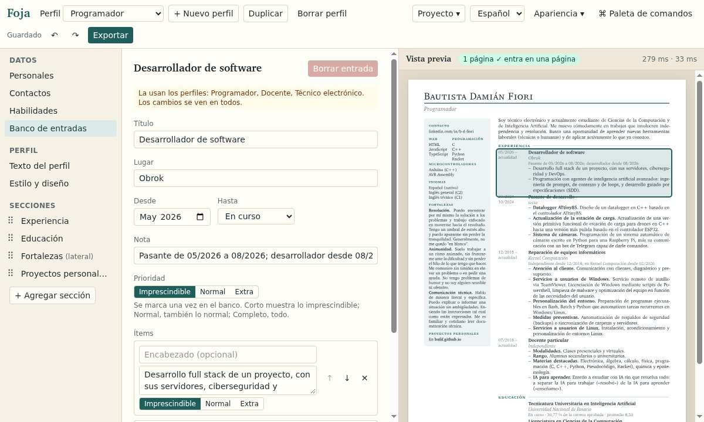

# Foja

**Your CV in Typst, without writing code.** 
[Español](README.es.md) · [Open the editor](https://bafif.github.io/foja/) · [Install](#install) ·
[User guide](docs/guide.md)

You fill in forms and the preview next to them is the real [Typst](https://typst.app) output, updated as you type.
One bank of entries feeds several profiles: the CV for a programming job and the one for a teaching post come from
the same data. Everything runs in your browser, with no accounts and no server.

## Why Foja

- **One bank, one CV per kind of job.** Each entry is written once and marked essential, normal or extra; each
  profile picks its sections from the bank, and its length (short, normal, full) decides what goes in.
- **One page, no guessing.** The preview says whether the CV fits and tints what spills over. “Fit to one page” trims
  the profile one step at a time, in a fixed order, and one undo brings it back.
- **Nine styles, and your own in Typst.** Legajo, Banda and Minimal; Claustro, Recto and Llano for applicant tracking
  systems, one column of plain text in reading order, which a test checks in the PDF; Arco, Rótulo and Portada for a
  short CV. “Edit in Typst” copies any of them into a style of your own.
- **Bring the template you like.** A Typst or LaTeX CV template is read with fixed rules, no AI: its sample content
  becomes a profile and its look a style, after a form where you check which argument is which field.
- **Export to whatever they ask for.** PDF, JPG, Word, Typst, LaTeX, Markdown, JSON and JSON Resume, each with exactly
  what the PDF shows. JSON Resume comes in too.
- **Your CV stays with you.** Typst compiles in your browser, the project lives there and in the files you export, and
  the site connects to nothing but itself. It works offline, installs as an app and speaks Spanish and English.

## Install

Nothing to install: open [bafif.github.io/foja](https://bafif.github.io/foja/). To have it as an app, with its own
icon and offline:

- **On a computer**, install it from Chrome's or Edge's install button.
- **On Android**, in Chrome: “⋯ → Install as an app” in Foja's menu.
- **On iPhone and iPad**, in Safari or Chrome: “Share → More → Add to Home Screen”. If your CV lives on an iPhone,
  install it: iOS deletes what a site saved after a week without opening it, unless it is on the Home Screen.

There are also a desktop app and a command line, not published yet (see [Status](#status)): the
[user guide](docs/guide.md#the-desktop-app) and the [command line's README](packages/cli/README.md) describe them.

## How to use it

1. **Open the editor** and start with the example (a real CV with three profiles), one of the made-up people, an empty
   project, or a Foja or JSON Resume file.
2. **Write your entries** in “Data”: personal details, contacts, skills and the bank of jobs, studies and projects.
3. **Make a profile per kind of job**: its text, its sections, its style and its length, until the badge says it fits
   on one page.
4. **Export** (Ctrl+E) to the format they ask for, and export the project as JSON now and then to keep a copy outside
   the browser.

The whole editor, step by step, is in the [user guide](docs/guide.md).

## Status

- **Web editor:** online, on computers and phones. On phones it is tested in an emulated phone in Chromium; the full
  test on a real Android and a real iPhone is still to be done.
- **Exports:** Word is checked by opening it in LibreOffice, not yet in Microsoft Word. Word and LaTeX lay the text
  out a little differently from Typst, so a CV that just fits in the PDF can run a few lines over; making them match
  is next on the [roadmap](docs/ROADMAP.md).
- **Desktop app:** the Linux packages are built and tried; the Windows and macOS installers are built but have not
  been tried. No version has been published yet.
- **Command line:** works from a clone of the repository; it is not on npm yet.

## More documentation

- [User guide](docs/guide.md): profiles, styles, imported templates, exports, phones and the desktop app.
- [Writing a style](docs/templates.md): what a Typst style receives and the helpers it can use.
- [Interface themes](docs/themes.md): a theme of your own, as a JSON file or from a script.
- [Security model](docs/security.md): what a project, a style, a template or a theme from someone else can do.
- [Command line](packages/cli/README.md): `foja build`, `validate` and `import`.
- [Development](docs/development.md): the repository's layout, the containers, the tests, the deploy and the
  desktop builds.
- [Roadmap](docs/ROADMAP.md): principles, decisions and their reasons, and what comes next.
- [cvgen](cvgen/README.md): where Foja started, the author's CV as data and its generators in Python (through LaTeX)
  and in C.

## Licence

GPL-3.0. See [LICENSE](LICENSE).
